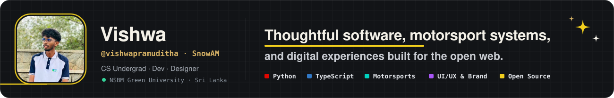
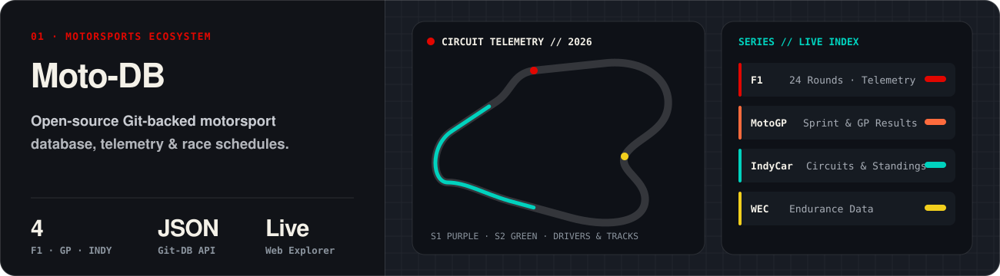
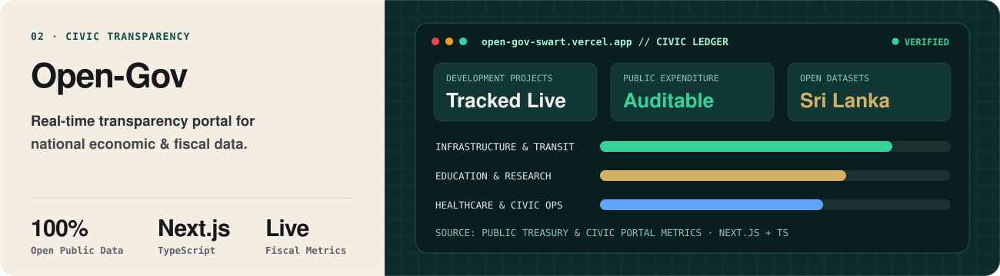
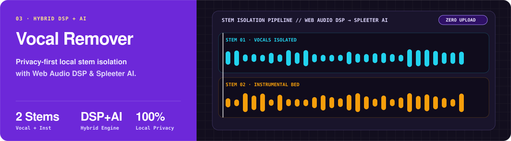
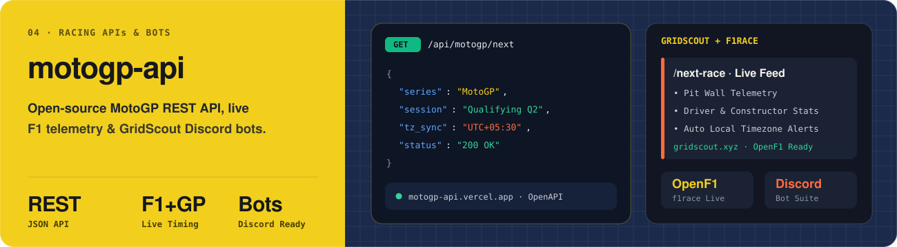

<b>Computer Science undergraduate, software developer &amp; graphic designer.</b> 
<b>Building open-source motorsport telemetry, civic transparency tools, and developer utilities — aka <a href="https://snowam.is-a.dev/">SnowAM</a>.</b>

## 🏎️ Moto-DB

<b>An open-source, developer-friendly database of schedules, race results, driver profiles, and track metadata for major motorsports.</b> 
<b>Covers Formula 1, MotoGP, IndyCar, and WEC as a Git-backed JSON database paired with a live web explorer and telemetry tools.</b>

## 🏛️ Open-Gov

<b>Real-time transparency portal for national economic data, development projects, and civic expenditure.</b> 
<b>Built with TypeScript and Next.js to make Sri Lanka's public fiscal metrics accessible, searchable, and verifiable.</b>

## 🎙️ Vocal Remover

<b>Privacy-focused local vocal remover powered by a Hybrid DSP + AI pipeline.</b> 
<b>Combines instant client-side Web Audio DSP previews with a local Spleeter AI backend for clean vocal and instrumental stem isolation.</b>

## 📦 postal-npm

<b>Lightweight, zero-dependency npm package for developers to access Sri Lankan postal codes and city names.</b> 
<b>Shipped with full TypeScript definitions for fast autocomplete, validation, and reverse lookup across every district.</b>

## 🏁 motogp-api &amp; GridScout

<b>Open-source MotoGP REST API alongside live F1 telemetry (<a href="https://github.com/vishwapramuditha/f1race">f1race</a>) and racing Discord bots (<a href="https://github.com/vishwapramuditha/GridScout">GridScout</a>).</b> 
<b>Built for motorsport fans and developers needing live session timing, driver standings, and timezone-aware race schedules.</b>

